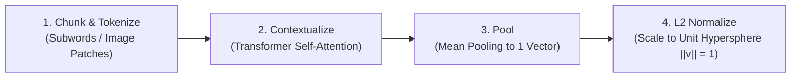

# 1. The Core Mental Model & How Embeddings Are Generated

> **TL;DR:** An embedding model is a deterministic function `f(input) -> float[N]` that maps messy, unstructured data (text, code, images, audio) onto a multi-dimensional unit hypersphere where **geometric proximity equals semantic similarity**.

---

## 1.1 The Problem with Exact Matching (`SQL LIKE`)

Computers are built for exact byte comparisons:
```sql
SELECT * FROM articles WHERE title LIKE '%flickering%';
```
If a user searches *"my laptop screen is flickering"*, exact keyword matching completely misses a support article titled *"Troubleshooting display refresh glitches"* because they share **zero words**.

Embeddings solve this by converting both sentences into **coordinates in meaning space** before comparing them.

---

## 1.2 The "Zero-Math" Mental Model: The 2D Taste Map

Imagine plotting foods on a simple 2D chart with two human-named axes:
- **X-Axis:** Sweetness (`0` to `10`)
- **Y-Axis:** Crunchiness (`0` to `10`)

| Food Item | Sweetness (X) | Crunchiness (Y) | 2D Embedding (`float[2]`) |
| :--- | :---: | :---: | :--- |
| **Apple** | 7.5 | 8.0 | `[ 7.5, 8.0 ]` |
| **Crispy Pear** | 7.0 | 7.2 | `[ 7.0, 7.2 ]` |
| **Potato Chip** | 1.2 | 9.2 | `[ 1.2, 9.2 ]` |
| **Chocolate Cake** | 9.4 | 1.5 | `[ 9.4, 1.5 ]` |
| **Raw Broccoli** | 1.5 | 6.8 | `[ 1.5, 6.8 ]` |

Notice what just happened:
1. You created a **2-dimensional vector embedding** without doing any linear algebra.
2. **Apple** (`[7.5, 8.0]`) and **Crispy Pear** (`[7.0, 7.2]`) naturally landed right next to each other.
3. If someone asks for *"something sweet and crunchy"*, you simply check which point sits closest to `[8.0, 8.0]`.

### Scaling from 2 Axes to 384–3,072 Axes
Modern embedding models (such as `all-MiniLM-L6-v2`, `Qwen3-Embedding`, `Gemini Embedding 2`, or `text-embedding-3`) do the exact same thing—except instead of 2 human-named axes, they project inputs onto **384 to 3,072 abstract latent axes** learned from billions of training examples.

---

## 1.3 Cosine Similarity in One Sentence

To compare two vectors, we draw arrows from the origin `(0, 0)` to each point and measure the **angle $\theta$** between them:

$$\text{CosineSimilarity}(\vec{A}, \vec{B}) = \cos(\theta) = \frac{\vec{A} \cdot \vec{B}}{\|\vec{A}\| \|\vec{B}\|}$$

- **$\cos(0^\circ) = +1.0$**: Arrows point in the exact same direction (identical semantic meaning).
- **$\cos(90^\circ) = 0.0$**: Arrows are perpendicular/orthogonal (unrelated concepts).
- **$\cos(180^\circ) = -1.0$**: Arrows point in opposite directions.

> **Senior Engineering Optimization:** Almost all modern embedding models normalize their output vectors to **unit length ($\|\vec{v}\| = 1.0$)** as their final step. Once $\|\vec{A}\| = 1$ and $\|\vec{B}\| = 1$, the denominator disappears and **Cosine Similarity becomes mathematically identical to the Dot Product**:
> ```csharp
> // In .NET 10, both are hardware SIMD-accelerated (AVX2 / AVX-512 / ARM NEON):
> float similarity = TensorPrimitives.Dot(vecA.Span, vecB.Span);
> ```

---

## 1.4 Under the Hood: The 4-Stage Generation Pipeline

Beginners often assume an embedding model is a giant static lookup table. In reality, every input passes through a **4-stage neural pipeline**:



### Stage 1: Chunk & Tokenize (Chopping into IDs)
- **Text** is split into sub-word tokens (`"unbelievable"` $\rightarrow$ `["un", "believ", "able"]` $\rightarrow$ `[348, 9102, 481]`).
- **Images** are sliced into a grid of square patches (e.g., $16 \times 16$ pixels per patch), flattened just like words in a sentence.
- **Audio** is converted into a spectrogram (a visual heatmap of frequencies over time) and sliced into patches just like an image.

### Stage 2: Contextualize (Transformer Self-Attention Layers)
Each token starts with a static lookup vector, then passes through multiple Transformer self-attention layers where tokens exchange context with every other token in the sequence:
- In *"I dropped my **apple** and cracked the screen"*, the token `"apple"` attends to `"dropped"` and `"screen"`, shifting its vector toward **consumer electronics / iPhone**.
- In *"I ate a crisp **apple** orchard snack"*, the token `"apple"` shifts toward **fruit / food**.

### Stage 3: Pool (Squashing $T$ Token Vectors into 1 Vector)
After the transformer layers finish, a 200-token paragraph has 200 separate vectors. A **Pooling Layer** (most commonly **Mean Pooling**, which averages all token vectors across each dimension) squashes those 200 vectors into a **single fixed-length `float[N]` array**.

### Stage 4: L2 Normalize (Unit Length)
Finally, the vector is divided by its Euclidean norm ($\|\vec{v}\|$) so that its length equals `1.0`. Every embedding now lives on the surface of an $N$-dimensional unit sphere.

---

## 1.5 How Did the Model Learn Where to Put Things? (Contrastive Learning)

Embedding models are trained via **Contrastive Learning** on hundreds of millions of triplets:
- **Anchor ($Q$):** `"credit card won't go through"`
- **Positive Match ($P^+$):** `"Payment gateway returns 502 error at checkout"`
- **Hard Negative ($N^-$):** `"How do I reset my two-factor authentication?"`

During training, the loss function (InfoNCE) **pulls $(Q, P^+)$ closer together** on the hypersphere and **pushes $(Q, N^-)$ apart**. Over billions of examples, the network carves out a coherent geometry of human concepts.
