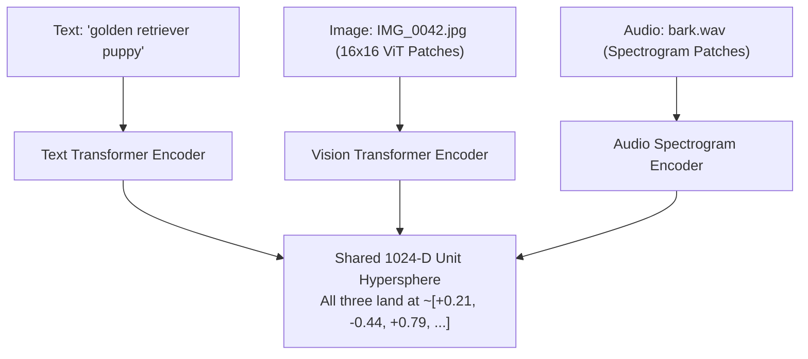

# 2. Multimodal Embeddings & How to Choose a Model

## 2.1 How Images, Audio, and Text Share the Exact Same Vector Space

Historically, text models and computer vision models lived in completely separate coordinate universes—a text vector `[0.12, -0.84, ...]` had zero geometric relationship to an image vector `[0.12, -0.84, ...]`.

Modern **Multimodal Embedding Models** (such as **CLIP**, **SigLIP 2**, **Gemini Embedding 2**, and **Qwen3-VL-Embedding**) train dual or unified encoders side-by-side on paired multimodal data:

### The Engineering Payoff
Your vector database (`pgvector`, Qdrant, Milvus, or in-memory C# `ReadOnlyMemory<float>`) **does not care where the `float[]` array came from**:
- You can embed 10,000 untagged mobile bug screenshots, architecture diagrams, audio support calls, and markdown runbooks into a single table.
- A user types a natural-language query (`"diagram with red arrows"` or `"error toast on mobile checkout"`), and a single nearest-neighbor query retrieves matching screenshots, PDFs, and markdown docs simultaneously—with **zero manual tagging or OCR pipelines**.

### A Subtle Engineering Reality: "The Modality Gap"
Even inside a shared multimodal space, vectors from different modalities tend to hover in slightly separated sub-clouds (like oil and water):
- A text query will often have `0.78–0.90` cosine similarity with matching text chunks, but `0.28–0.42` cosine similarity with matching raw images in classic CLIP models.
- **Production Fix:**
  1. Newer unified models (SigLIP, Gemini Embedding 2, Qwen3-VL) significantly shrink this modality gap.
  2. When mixing text and images in a single search query, either **mean-center per modality** (subtract the average image vector from image embeddings and average text vector from text embeddings before L2-normalizing) or calibrate separate similarity thresholds per modality.

---

## 2.2 Why Embedding Models Differ: The 5 Engineering Axes

Beginners often look at the HuggingFace MTEB Leaderboard and assume "#1 overall is best for my system." In production engineering, models differ across **5 practical axes**:

| Axis | What Varies Between Models | Why It Matters in Engineering |
| :--- | :--- | :--- |
| **1. Specialization (Symmetric vs. Asymmetric)** | **Symmetric** models compare similar lengths (sentence $\leftrightarrow$ sentence). **Asymmetric Retrieval** models match short queries (`5 words`) against long passages (`500 words`). **Code** models (`voyage-code-3`) understand AST/syntax semantics. | Many asymmetric models (e.g., E5, BGE, Nomic) require explicit prefixes like `"query: "` for user searches and `"passage: "` when indexing documents. Omitting them drops recall by 10–20%! |
| **2. Context Window** | Older models (`all-MiniLM-L6-v2`) cap at **256–512 tokens** (~350 words). Modern models (`text-embedding-3`, `BGE-M3`, `Qwen3`, `Nomic`) support **8,192 to 32,768+ tokens**. | **Silent Truncation Trap:** Most tokenizers silently drop every token past the model's max context window. Feeding a 5-page doc into a 512-token model ignores pages 2–5 completely! |
| **3. Dimensions & Matryoshka Support** | Ranges from **384 dims** (tiny, fast) to **768 / 1,024 / 1,536 / 3,072 dims**. | Higher dimensions capture finer nuance but cost linear RAM & index build time. Models trained with **Matryoshka Representation Learning (MRL)** let you slice `3072 -> 512` dims on the fly. |
| **4. Multilingual & Domain Bias** | English-only web corpora vs. 100+ languages vs. specialized finance/legal/medical training. | An English-only model maps non-English queries almost randomly. Conversely, a massive 100-language model uses parameter capacity on languages you may not need. |
| **5. Local ONNX / Ollama vs. Cloud API** | Local open-weight models (`all-MiniLM-L6-v2`, `bge-small`, `EmbeddingGemma`, `nomic-embed-text`) vs. Hosted APIs (OpenAI, Azure, Gemini, Voyage, Cohere). | **Local ONNX in C#:** `< 2ms` latency, `$0` per token, zero external network dependency, 100% data privacy. **Hosted APIs:** Zero GPU/CPU compute management for huge batch indexing. |

---

## 2.3 Pragmatic Model Shortlist for .NET Engineers

1. **Fastest Local CPU / Offline .NET (`ElBruno.LocalEmbeddings` / ONNX):**
   - `sentence-transformers/all-MiniLM-L6-v2` (384 dims, ~90 MB ONNX) or `BAAI/bge-small-en-v1.5` (384 dims).
2. **Best Local Server / Ollama / vLLM Open Weights:**
   - `nomic-embed-text-v1.5` (768 dims, Matryoshka down to 64 dims, 8K context)
   - `BAAI/bge-m3` (1024 dims, 100+ languages, 8K context, dense + sparse hybrid)
   - `Qwen3-Embedding` / `EmbeddingGemma`
3. **Best Cloud APIs (via `Microsoft.Extensions.AI`):**
   - **OpenAI / Azure OpenAI:** `text-embedding-3-small` (1536 dims, MRL) & `text-embedding-3-large` (3072 dims, MRL, best slicing to 512/1024).
   - **Google Gemini:** `gemini-embedding-exp` / `text-embedding-004` (Matryoshka support + multimodal shared spaces).
   - **Voyage AI:** `voyage-3-large` / `voyage-code-3` (top-tier code & technical retrieval).
